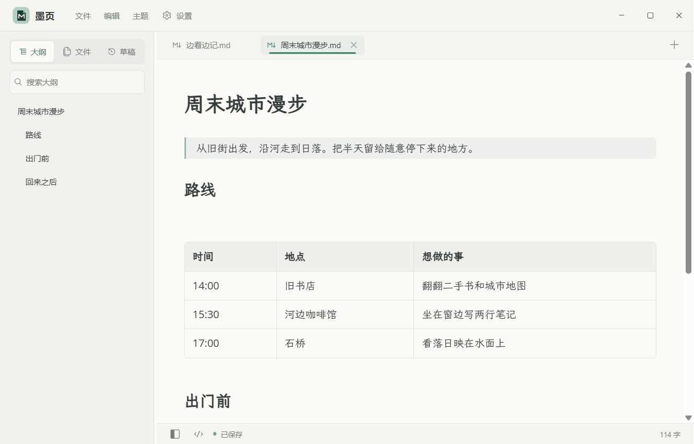
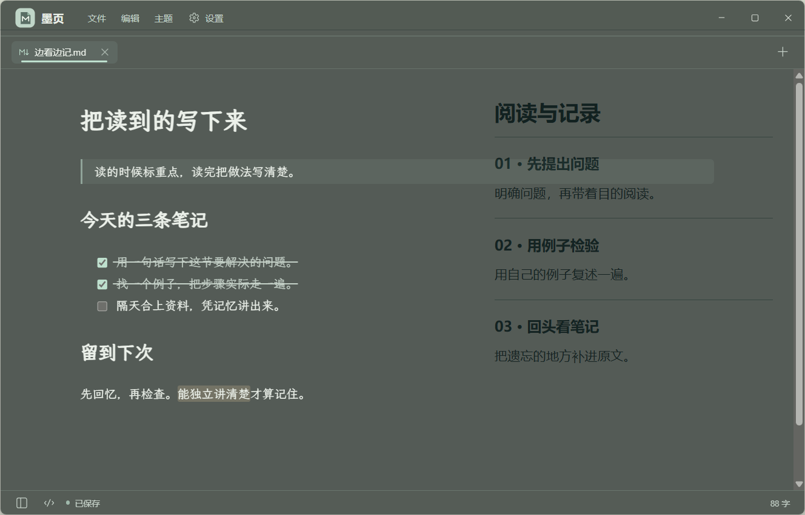

<p align="center"></p>
<h1 align="center">墨页 Moye</h1>
<p align="center">在 Windows 上边写 Markdown，边看排版。笔记就保存在你选的文件夹里。</p>
<p align="center"><a href="https://github.com/qqbb111/Moye/releases/latest"><strong>下载 Windows x64 便携版</strong></a> · <a href="#开始使用">开始使用</a> · <a href="CHANGELOG.md">版本记录</a></p>



## 写作与阅读

- **边写边排版。** 标题、表格、代码块、KaTeX 公式和 Mermaid 图在正文里即时呈现。按 `Ctrl+/` 可在排版和源码之间切换，并留在当前阅读位置。墨页内置霞鹜文楷，也可以一键整理中英文间距。
- **在多份笔记之间来回查阅。** 用标签页、独立窗口、文件树和大纲组织资料，按 `Ctrl+P` 搜索文件名。未命名草稿留在本机，下次打开可以接着写。
- **把技术笔记带到纸上。** PDF 预览支持 A4 单栏或双栏、黑白省墨和浅色高亮。长代码按行跨页，可以调整字号和行号。技术文档也可导出为 HTML。[查看实际打印预览](docs/print-preview.png)

## 透明主题预览

把墨页放到参考资料前，切换「主题 → 透明」，就可以边读背后的内容边记笔记。整窗不透明度可在「设置 → 常规」调节。



透明主题已加入主分支，可从源码体验。当前 GitHub Release 的便携包暂未包含该主题。

## 开始使用

1. 在 [Releases](https://github.com/qqbb111/Moye/releases/latest) 下载 `Moye-…-windows-x64.zip`，解压整个目录，运行 `Moye.exe`。运行环境和字体已随包提供。
2. 点标签栏的「＋」新建，或按 `Ctrl+O` 打开已有的 `.md` 文件。
3. 在「主题」切换界面和代码配色，在「文件」导出 PDF 或 HTML，在「设置 → 快捷键」修改按键。

已安装的用户可以在「设置 → 关于 → 检查更新」获取正式版。0.9.8 用户需要手动升级一次。便携版目前未签名，首次启动时 Windows 可能显示 SmartScreen 提示，下载页提供 ZIP 的 SHA-256 校验值。

<details>
<summary>文件、图片与草稿放在哪里？</summary>

保存过的 Markdown 放在你选的文件夹。相对图片从文档目录及其子目录加载，其他图片可通过「插入图片」复制为附件。PDF 中无法加载的图片会显示占位，正文照常导出。

草稿、打开的标签和偏好记录在 `%APPDATA%\Typora Replica\recovery\workspace.json`，上一份有效记录为同目录的 `workspace.json.bak`。未随文档保存的图片附件位于 `recovery\assets`。重装或迁移电脑前，可备份整个 `recovery` 目录。

</details>

<details>
<summary>从源码构建与验证</summary>

使用 Node.js 24，在 Windows 上运行：

```powershell
npm ci
npm run build
npm start
```

- `npm test` 跑单元测试，`npm run test:e2e` 跑桌面测试。
- `npm run package` 生成本机便携版，可用项目根目录的 `启动Typora.bat` 启动。
- `npm run package:zip` 生成 Windows x64 ZIP，`node scripts/smoke-release.mjs --targeted` 验证刚解压的便携包。

[Windows CI](https://github.com/qqbb111/Moye/actions/workflows/windows-ci.yml) · [霞鹜文楷许可](assets/fonts/LICENSE-LXGWWenKai.txt) · [Source Code Pro 许可](assets/fonts/LICENSE-SourceCodePro.txt) · [第三方声明](THIRD_PARTY_NOTICES.txt)

</details>
