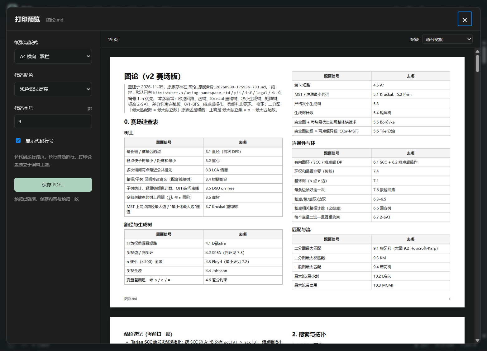

<p align="center"></p>
<h1 align="center">墨页 Moye</h1>
<p align="center">面向日常笔记、学习资料与技术文档的 Windows Markdown 编辑器。</p>
<p align="center"><a href="https://github.com/qqbb111/Moye/releases/latest"><strong>下载 Windows x64 便携版</strong></a> · <a href="#功能介绍">功能介绍</a> · <a href="#开始使用">开始使用</a> · <a href="CHANGELOG.md">版本记录</a></p>


墨页在输入 Markdown 时直接呈现排版，支持透明窗口对照资料，也能把带代码、表格和公式的笔记整理成 PDF。笔记保存为普通 `.md` 文件，可以继续使用自己的文件夹管理资料。

## 功能介绍

### 即时排版与直接编辑

- **写下去就能看到效果。** 标题、引用、列表、任务、链接和图片在正文中呈现，技术笔记还可以加入数学公式与 Mermaid 图表。
- **随时查看原文。** 在排版与源码模式之间切换时，以当前可见内容保留阅读位置，检查 Markdown 后可以继续读写。
- **直接修改表格。** 点击单元格编辑，用 `Tab` 切换单元格、在末尾续行；工具栏支持增删行列和调整对齐，减少手动维护 Markdown 竖线的操作。
- **整理中文笔记。** 对选区或全文整理中英文间距、数字单位和常见标点，保留代码、公式及链接目标；也可按需开启保存前整理。

### 长文与多文档导航

- **树状大纲。** 按标题层级展开或收起章节，点击跳转；搜索大纲时保留真实的上级标题，长文结构仍然清楚。
- **多标签与独立窗口。** 拖动标签调整顺序，标签较多时用鼠标滚轮横向浏览，也可以把文档移到独立窗口并排查看。
- **文件树与快速打开。** 打开笔记文件夹浏览目录，在原位置重命名文件；按 `Ctrl+P` 通过文件名或路径查找已打开、最近使用及当前目录中的文档。
- **查找与替换。** 在当前文档中定位关键词、替换文字，配合大纲浏览学习笔记、项目记录和长篇资料。

### 对照资料记笔记

切换「主题 → 透明」，可以透过墨页看到背后的参考资料，适合边阅读边摘录、对照代码记笔记。整窗不透明度可在「设置 → 常规」调节，并在下次启动时保留。


### 技术笔记与打印

代码块支持语法高亮、语言选择和一键复制；长行可以横向滚动，也可以自动折行。代码配色可独立选择，并支持读取本机 VS Code 的代码配色。

导出 PDF 时使用独立的纸张排版，编辑器中的深色主题也可以输出为白底黑字。适合打印算法竞赛模板、课程笔记和技术速查资料。

<table>
  <thead><tr><th align="left" nowrap>打印选项</th><th align="left" width="1000">可选设置</th></tr></thead>
  <tbody>
    <tr><td nowrap>纸张与版式</td><td>A4 纵向单栏、A4 横向双栏</td></tr>
    <tr><td nowrap>代码配色</td><td>黑白省墨、浅色语法高亮</td></tr>
    <tr><td nowrap>代码字号</td><td>8–12 pt，单栏和双栏分别记住设置</td></tr>
    <tr><td nowrap>代码行号</td><td>按需显示或隐藏</td></tr>
    <tr><td nowrap>页脚</td><td>文档名、当前页与总页数</td></tr>
  </tbody>
</table>

长代码支持按行跨页，长行自动折行；在预览中确认页面后，保存的就是当前预览对应的 PDF。无法加载的图片会在原位置显示占位，其他内容可以继续导出。笔记也支持导出为 HTML，方便用浏览器查看和分享。



### 外观与操作习惯

- **多种主题。** 默认使用白色主题，也提供夜间、WorkBuddy 深色、Copilot 深色和透明主题，适应不同的阅读环境。
- **调整阅读布局。** 可设置正文字号、阅读宽度和侧栏宽度，按需要显示标签栏、折叠侧栏，给正文留出空间。
- **自定义快捷键。** 在设置中按文件、编辑、段落、格式等功能分类查找操作，修改、清除或恢复按键；主题、字号等设置直接生效。
- **字体随包提供。** 内置霞鹜文楷与 Source Code Pro，无需在另一台电脑上额外安装。本地笔记编辑、内置字体和 PDF 预览可离线使用。

## 开始使用

1. 在 [Releases](https://github.com/qqbb111/Moye/releases/latest) 下载 `Moye-…-windows-x64.zip`，完整解压后双击目录里的 **`Moye.exe`**。运行环境和字体已随包提供。
2. 点标签栏的「＋」新建，或按 `Ctrl+O` 打开已有的 `.md` 文件；也可以从「文件」打开整个笔记文件夹。
3. 直接开始写作，按 `Ctrl+S` 保存到自己的目录。在「主题」调整外观，在「文件」导出 PDF 或 HTML。

**后续更新：** 在「设置 → 关于 → 检查更新」中检查、下载并安装新版，无需每次手动下载解压。0.9.8 用户需要手动升级一次。检查更新、访问外链和加载网络图片需要联网。

便携版目前未签名，首次启动时 Windows 可能显示 SmartScreen 提示，下载页提供 ZIP 的 SHA-256 校验值。

## 文件、图片与草稿

笔记保存在本机，不需要注册账号。保存后的 `.md` 文件位于你选择的文件夹，可以继续用其他 Markdown 工具打开。

草稿恢复目录：<code>%APPDATA%\Moye\recovery</code>

<table>
  <thead><tr><th align="left" nowrap>内容</th><th align="left" width="1000">恢复目录内的位置</th></tr></thead>
  <tbody>
    <tr><td nowrap>草稿、标签和设置</td><td><code>workspace.json</code></td></tr>
    <tr><td nowrap>有效备份</td><td><code>workspace.json.bak</code></td></tr>
    <tr><td nowrap>草稿图片</td><td><code>assets</code></td></tr>
  </tbody>
</table>

粘贴或插入的图片作为附件管理，保存和另存为时携带资源。已有相对图片从文档目录及其子目录加载，目录外的图片可通过「插入图片」复制为附件。

已保存的文件默认自动保存，也可在设置中关闭。未命名草稿、打开的标签和偏好会在本机恢复；发现磁盘文件被外部修改时，会提示处理冲突。从旧版升级时复制恢复数据并保留旧目录，新旧数据各有内容时会提示旧数据的位置。

## 常用快捷键

<table>
  <thead><tr><th align="left" nowrap>操作</th><th align="left" width="1000">默认快捷键</th></tr></thead>
  <tbody>
    <tr><td nowrap>切换源码与排版</td><td><code>Ctrl+/</code></td></tr>
    <tr><td nowrap>快速打开文档</td><td><code>Ctrl+P</code></td></tr>
    <tr><td nowrap>插入表格</td><td><code>Ctrl+T</code></td></tr>
    <tr><td nowrap>插入代码块</td><td><code>Ctrl+Shift+K</code></td></tr>
    <tr><td nowrap>整理中文排版</td><td><code>Alt+Shift+F</code></td></tr>
    <tr><td nowrap>打开设置</td><td><code>Ctrl+,</code></td></tr>
  </tbody>
</table>

更多操作与按键可在「设置 → 快捷键」中搜索和修改。

## 从源码构建与验证

使用 Node.js 24，在 Windows 上运行：

```powershell
npm ci
npm run build
npm start
```

- `npm test` 跑单元测试，`npm run test:e2e` 跑桌面测试。
- `npm run package` 生成本机便携版，入口为 `release/Moye-win32-x64/Moye.exe`。仓库根目录的 `启动墨页.bat` 是开发用快捷脚本。
- `npm run package:zip` 生成 Windows x64 ZIP，`node scripts/smoke-release.mjs --targeted` 验证刚解压的便携包。

[Windows CI](https://github.com/qqbb111/Moye/actions/workflows/windows-ci.yml) · [霞鹜文楷许可](assets/fonts/LICENSE-LXGWWenKai.txt) · [Source Code Pro 许可](assets/fonts/LICENSE-SourceCodePro.txt) · [第三方声明](THIRD_PARTY_NOTICES.txt)
