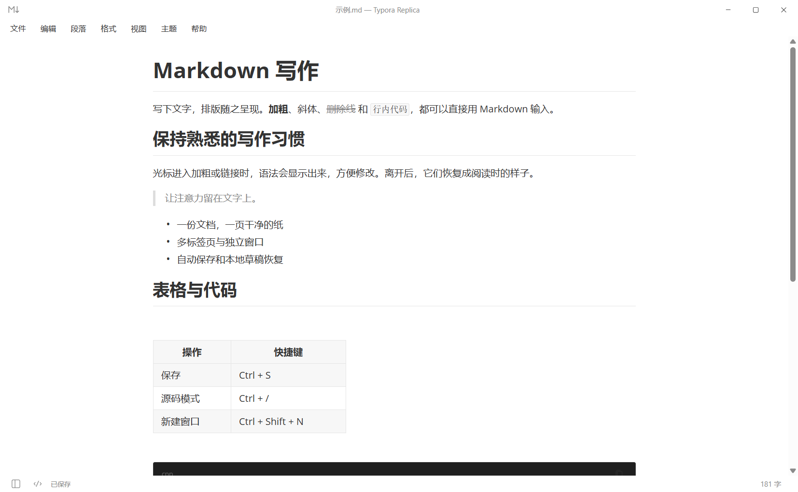
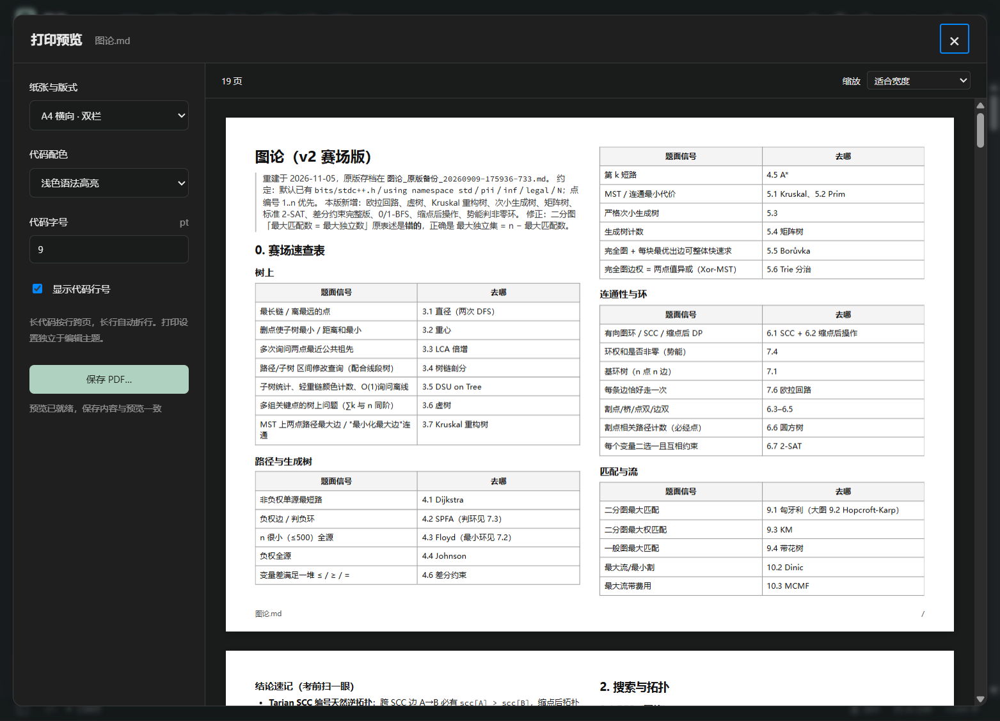
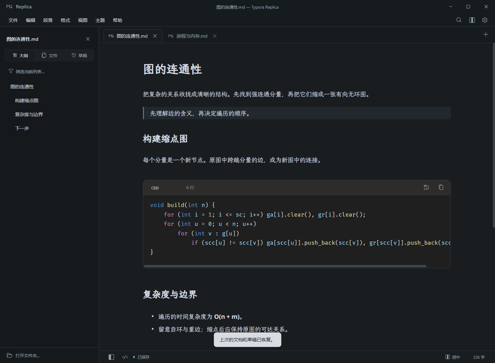
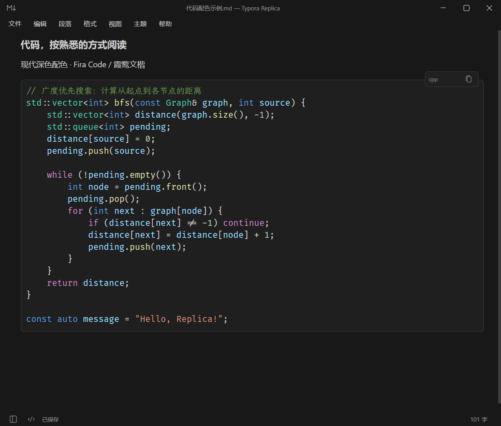
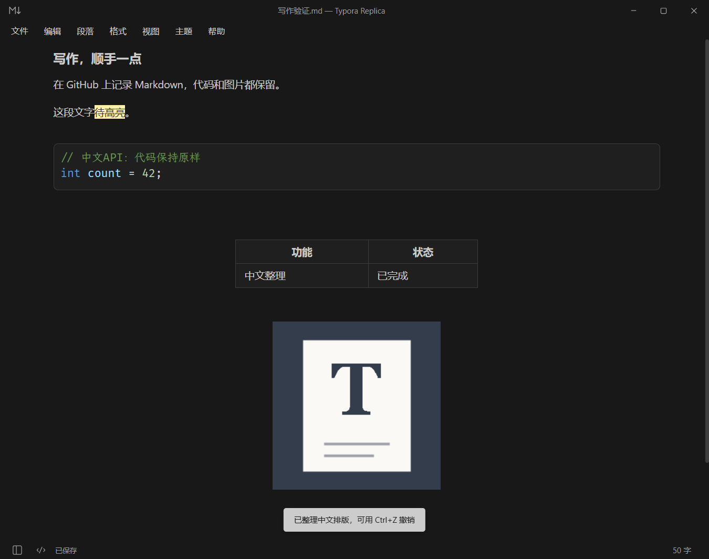
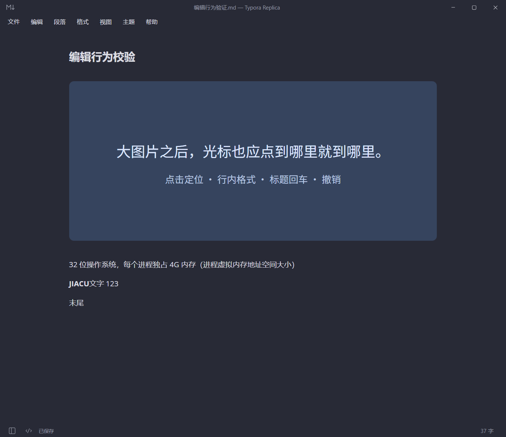

# 墨页 Moye

保留 Markdown 原文的 Windows 即时排版编辑器，面向中文写作、学习笔记与代码阅读。默认采用 WorkBuddy 深色排版，正文使用系统无衬线字体、代码使用内嵌 Source Code Pro；另保留文楷正文的浅色、夜间与 Copilot 深色主题，文档统一显示在可拖动标签栏。



## 界面与 Windows 任务栏

标题栏只保留一个设置入口。设置采用顶部分类：常规、文件、编辑、段落、格式、视图、快捷键、关于；文档名称集中在标签栏，新建使用“＋”。文件打开、格式和视图操作都可从设置分类页执行。保留底栏侧栏/源码快速切换，去掉传统多项顶栏菜单。常规页采用对齐表单与开关；中文整理的补充说明通过信息按钮按需展开，支持键盘和 Esc。正文继续采用 WorkBuddy 排版。

侧栏先完成一次布局，再通过约 220ms 的合成层位移完成开合，避免逐帧改变宽度而反复重排长文档；快速反向操作接续当前位置。标签、设置分类和弹窗使用轻量过渡，输入与侧栏拖动不加延迟，遵循系统“减少动态效果”设置。

进程、窗口、开始菜单及已有固定快捷方式统一使用稳定 AppUserModelID；仅修复指向当前 EXE 的通用入口，保留固定位置与新窗口参数，不改变其他应用和文档专属快捷方式。安装版启动时会维护「墨页 Moye」开始菜单入口，并提供“新建窗口”任务。Windows 若缓存了旧固定入口，可取消固定旧图标，再固定运行中的墨页一次。后续版本保留相同标识与启动路径。

软件改名后仍沿用原有用户数据目录，草稿、图片附件和设置继续恢复。现有启动脚本及 EXE 文件名保留兼容性；窗口、开始菜单、图标和程序文件属性显示「墨页 Moye」。

## 直接运行

双击项目根目录的 **启动Typora.bat**，或运行：

`release/Typora Replica-win32-x64/Typora Replica.exe`

便携版本已包含运行环境，无需安装 Node.js。移动软件时保留整个 `Typora Replica-win32-x64` 文件夹。可以把 `.md` 文件拖到 EXE 上打开。

## 写作与阅读体验

- **代码按原来的结构阅读**：WorkBuddy 预设默认折行并保留续行缩进；右上角换行按钮或代码内 `Alt+Z` 可切换为块内独立横向滚动。切换只改变显示，不改写代码，也不占用撤销记录。设置会在重启后保留。
- **代码工具就在块内**：WorkBuddy 显示行号，语言、换行和复制工具在悬停或编辑时出现；其他主题保留轻量标题栏。字号和行距独立适配，保留原始 `<=`、`!=` 等符号组合。
- **按内容选择页面宽度**：在设置的常规分类中选择紧凑、适中、宽阔。各主题均可调节页面宽度；适中宽度为 900。
- **侧栏跟随自己的习惯**：边缘可拖动调整宽度，双击恢复默认；聚焦分隔线后可用左右方向键微调。筛选框可查找当前大纲、草稿或文件列表，`Esc` 清空筛选并返回写作。文件树展开状态在编辑正文时保留；文件侧栏只展示当前文件夹，没有文件夹时展示已打开文档与打开文件夹按钮，当前文件保持高亮。
- **打开就能写**：启动、新建和打开文件后直接输入，保留各标签的光标和撤销状态。标签聚焦后可用左右方向键、Home/End 连续切换。
- **快速打开完整支持键盘**：`Ctrl+P` 支持标题与路径关键词，结果合并已打开、最近和当前文件夹并去重，以目录区分同名文件、勾号标记当前文档；上下键选择、Enter 打开，Esc 或点击外部返回，中文输入法组合中的 Enter 不会误打开文件。
- **保存状态随手可查**：底栏显示保存/草稿状态，鼠标停留可查看路径和保存时间；字数保留在右下角，详细统计按需点击查看。未命名文档的状态提示说明草稿保存在本机。

快捷键分类只编辑绑定，点击操作名称或组合键开始录制，不会执行该操作；录制完成或取消后焦点仍留在对应绑定。其他分类保留操作执行入口与选区。交互参考 [VS Code 快捷键编辑器](https://github.com/microsoft/vscode/blob/main/src/vs/workbench/contrib/preferences/browser/keybindingsEditor.ts)，复用现有命令表和冲突校验。

## WorkBuddy 深色排版

按用户提供的 smart-doc CSS 适配：页面 `#1f1f1f`、正文 16px／1.7，标题 26／22／18px、600 字重；引用、行内代码、满宽表格和带行号的代码块使用同一套灰阶。在 **设置 → 常规 → 主题** 选择 WorkBuddy 深色可启用。初次从旧版升级时默认应用这套外观，之后会记住手动选择，不影响文档、草稿和自动保存设置。

Source Code Pro 的 Regular／Bold／Italic 随程序附带，无需在系统安装。内置 Shiki 精确应用 `github-dark`；常用语言按需离线加载，包括 C/C++、JavaScript/TypeScript、Python、Java、JSON、Shell、HTML/CSS、Rust、Go、SQL、YAML、C# 和 Markdown。暂未内置的语言及超过 250,000 字符的单个代码块采用基础高亮，仍可正常编辑。HTML 导出沿用编辑排版、颜色和行号，并嵌入字体以便离线使用；PDF 使用独立打印排版。

代码编辑仍由 CodeMirror 管理，Shiki 只添加着色装饰，不替换输入 DOM 内容；组合输入期间延后着色，异步结果按文档版本校验，避免旧结果覆盖新输入。字体许可见 `assets/fonts/LICENSE-SourceCodePro.txt`，第三方声明随程序打包。

## 算法模板打印与 PDF 预览

选择 **设置 → 文件 → 导出 PDF**，左侧调整打印设置，右侧查看实际生成的 PDF、总页数及缩放。预览使用本地打包的 PDF.js，可离线使用，只渲染可见页面附近的内容。

| 设置 | 默认值与选项 |
| --- | --- |
| 纸张与版式 | A4 纵向单栏；可切换 A4 横向双栏，按左栏、右栏、下一页阅读 |
| 代码配色 | 黑白省墨；可切换 Shiki github-light 浅色语法高亮 |
| 代码字号 | 单栏 10pt、双栏 9pt；8–12pt、每次 0.5pt，两种版式分别记住字号 |
| 行号与页脚 | 默认显示原代码行号，以及文档名、当前页 / 总页数 |
| 页边距 | 顶部及左右 12mm，底部 14mm |

打印始终使用白底，不受编辑器主题、阅读宽度、代码换行设置影响。代码保留 Source Code Pro 和原始内容，长行自动折行并保留续行缩进，续行不重复行号。长代码按完整源代码行跨页、跨栏；排版后不超过 12 行的短块尽量保持完整，标题与后续内容连排。表格可跨页并重复表头，图片和公式适配栏宽，图片保留原色。导入 HTML 的折叠内容在打印时展开，滚动高度及深色内联样式清除，以免漏印内容。

长文先显示实际 PDF 首页，其余页面继续生成；整份完成后才允许保存。修改设置后约 400ms 重新排版，过期任务会取消；相同文档与设置在当前窗口内复用预览，图片会重新读取后校验。保存直接写入当前完整预览的 PDF 字节，不再另行排版。成功保存后才记住打印偏好；关闭预览使当前保存状态失效，关闭窗口释放缓存。打开预览时会保留文档快照，原文发生变化时会提示刷新；这些操作不会修改 Markdown 正文或编辑主题。字体与图片加载完成后才导出；失效的图片地址需要先修复。



## Copilot 深色排版

在 **设置 → 常规 → 主题** 选择 Copilot 深色。主题会随工作区保存，下次打开继续使用。

这个主题使用低饱和的蓝灰背景、柔和引用色和一致的标题层次。正文中文采用霞鹜文楷，英文采用 Open Sans，代码优先使用 Fira Code／Cascadia Code／JetBrains Mono，中文注释采用文楷回退字体。字体从本机读取；其他电脑未安装时按顺序回退。

打开 [Copilot 排版示例](docs/Copilot排版示例.md) 可以与参考截图对照。独立主题样式位于 `src/themes/copilot.css`。



## 标签、窗口与代码主题

按住标签左右拖动，整张标签会跟随鼠标移动，并以淡绿色占位框提示落点；其他标签随落点让位。整条标签栏均可接收拖放：拖到右侧空白或“＋”按钮区域会排到最后；标签溢出时，在边缘停留会持续横向滚动；拖出标签栏后松开、按 Esc 或窗口失焦均可取消。顺序随会话保存，拖动不会切换正在编辑的文档。标签仍可通过“设置 → 文件 → 移到新窗口”独立打开。

界面操作图标采用微软 [VS Code Codicons](https://github.com/microsoft/vscode-codicons) 的原始 SVG 符号，包括窗口按钮、标签关闭与新建、侧栏、文件树、代码复制和表格工具。最大化后切换为还原图标，关闭按钮悬停为红底。图标资源随程序打包，可离线显示。图标为 Microsoft 及其贡献者作品，按 CC BY 4.0 使用；原始图标与代码许可随 `THIRD_PARTY_NOTICES.txt` 提供。

Windows 任务栏右键菜单的应用入口会新建空白墨页窗口；再次双击 EXE、启动脚本或按 Ctrl+Shift+N 也可以新增窗口。后台协调文件和草稿存储，各个窗口独立编辑。开发更新时可以自动正常退出全部墨页窗口，先保存草稿再更新，无需反复向用户确认关闭。0.8.0 起支持在正在运行时以同一路径 EXE 加 `--quit-for-update` 请求正常退出；该路径会收集所有窗口当前编辑并写入恢复数据。确认退出后再替换程序，不把强制结束进程作为正常更新流程。已固定的旧快捷方式可能仍显示旧名称，但再次启动会打开新窗口。

代码块默认采用 **Shiki `github-dark`** 的 TextMate 语法高亮，也可在设置的常规分类中切换为 VS Code **现代深色（Dark Modern）** 或跟随本机 VS Code。右上角的双页图标用于复制代码，成功后短暂显示勾号。

通过 **设置 → 常规 → 代码配色 → 跟随本机 VS Code** 同步本机 VS Code 用户主题。程序读取本地用户 `settings.json` 和内置／已安装扩展的 JSON 主题，处理主题继承、通用 token 颜色与用户颜色自定义；约 1.5 秒检查一次变化。读取失败时会显示状态并保留可用配色。

同步范围是代码块的背景与语法颜色；正文排版继续使用墨页的所选主题。当前读取默认用户配置，不读取工作区、远程配置或具名配置文件；不连接 VS Code 账户。GitHub Dark 模式使用 Shiki 的 TextMate 高亮；跟随 VS Code 模式使用 CodeMirror 解析并映射通用 token 配色，未接入语言服务器，因此语义着色及部分语言细节仍有差异。



## 已实现

### 中文整理与图片附件

推荐保留自动保存，并按需使用 **设置 → 编辑 → 整理中文排版**（`Alt+Shift+F`）：有选区时整理选中的正文，否则整理全文，`Ctrl+Z` 可一步撤销。功能参照 [中文文案排版指北](https://github.com/sparanoid/chinese-copywriting-guidelines)，处理可机械判断的中英／数字空格、常见单位、全角数字、中文上下文中的常见标点。保护代码、公式、YAML、链接目标、图片和文件路径，不重排 Markdown 结构；专有名词大小写、语义和有争议的引号规则仍需人工判断。

需要保存时自动整理，可以在设置的常规分类启用 **保存前整理中文排版**（含自动保存），默认关闭。启用后先整理再保存，编辑区同步结果；如果写盘期间继续输入，不会用旧快照覆盖新输入。

粘贴图片保存为独立附件，未命名文档的图片保存在本机草稿附件目录；保存为 Markdown 后自动写入同级 `文档名.assets` 文件夹，并使用相对链接。移动或分享笔记时请带上该文件夹。旧版未命名草稿中的 Base64 图片会在恢复时无损转附件，也可以使用 **设置 → 编辑 → 整理图片附件**。图片编码和链接目标地址不进入正文统计。

表格可用 `Ctrl+T` 或“设置 → 段落”插入，随后直接输入；Tab 移到下一单元格，最后一格 Tab 增加一行，Enter 返回正文。WorkBuddy 主题的表格占满正文宽度，其他主题按内容决定宽度并水平居中，HTML 导出沿用对应布局；PDF 表格适配打印栏宽，单元格原有的列对齐方式保留。选中已有加粗文字按 `Ctrl+B` 可取消，支持 `**`、`__` 和局部取消；选中文字按 `=` 切换 `==高亮==`，正文与表格单元格均可使用，也兼容中文输入法的物理等号键。正在组合拼音时的按键仍交由输入法处理。



### 光标与行内编辑

图片、代码、表格和公式组件的间距统一纳入编辑器布局测量；组件尺寸变化后重新测量，正文点击、拖选及上下移动使用实际显示位置。不会因为前面有大图片就把正文中间的点击算到行尾。

无选区时，在词尾按 `Ctrl+B` 会加粗前一个词，保留光标在词后；中文使用分词识别，已有选区仍按选区切换。`**JIACU**文字 123` 可以直接相邻排版，无需人为插入空格。空段落按 `Ctrl+B` 后也可以继续输入加粗文字。

在标题文字开头按 Enter，会把整行标题下移，标题级别随行保留；在标题中间回车拆为标题和正文，在空标题上回车退出标题。移动和编辑均可撤销。

`Ctrl+Shift+Q` 或“段落 → 引用”可直接创建引用，创建后光标位于 `> ` 后，可立即输入。编辑引用行时，`>` 显示为淡色标记；光标移到其他行后隐藏。引用行的输入法组合过程中保留原来的预览结构，组合结束后更新排版；后台文本更新不会覆盖正在组合的内容。多行选择只处理实际选中的行，不额外改变选区末尾未选中的下一行。

没有选区时按 `Ctrl+C` 复制光标所在整行，按 `Ctrl+X` 剪切整行；在行末也可直接使用。自动折行的长段落仍视为同一条 Markdown 源行，格式标记一并保留；代码块内按代码行处理。剪切后可用 `Ctrl+Z` 一步恢复。有选区时仍只复制或剪切选中的文字；设置中的编辑操作、右键菜单与快捷键一致，表格单元格保留其原有选区操作。

有序列表按首项起点连续显示，例如源码全写 `1.` 时显示为 1、2、3……，嵌套列表独立计数；从 0 或其他数字起始、使用 `)` 的列表也支持。显示编号不会改写 Markdown 原文，编辑时保持递增显示；源码模式仍显示原始编号。HTML/PDF 导出保留列表的起始数字。



### 编辑与文件

- 即时排版：标题、加粗、斜体、删除线、下划线、链接、图片、引用、列表和任务勾选。光标进入行内格式时显示 Markdown 语法，离开后恢复排版。
- Markdown 原文作为编辑数据，切换源码不会重新序列化或统一格式；保存时保留打开文件的 UTF-8 BOM 和 CRLF/LF 换行。
- Enter 新段落、Shift+Enter 段内换行；新段开头退格或上一段末尾 Delete 会整体移除段落分隔，不残留半个换行。源码模式保持逐字符编辑；列表续写、括号配对、选中文字后加格式；输入三个反引号后 Enter 创建代码块。
- 独立代码编辑区、语言选择、语法高亮和复制；支持 Mermaid 图表预览。
- 表格直接编辑单元格、Tab 导航、增减行列和设置对齐；源码模式下可直接修改整个表格。
- 行内和块级 LaTeX 公式、脚注提示、`[toc]` 目录、YAML 元数据、常见 Emoji 名称补全、高亮和上下标。
- 多标签左右拖动排序、多窗口、将标签移到独立窗口；每个标签保留自己的编辑状态和撤销历史，任务栏再次启动新增窗口。
- 文件打开、保存、另存为、最近文件、快速打开和文件夹树；支持中文路径。
- 自动保存、本地草稿、正常退出恢复、异常退出后恢复已经落盘的内容；关闭未命名文档后可从草稿栏找回。
- 自动同步未修改文件的外部变化；有本地修改时保留草稿并阻止自动覆盖外部文件。
- 插入、拖放和粘贴图片；未命名文档使用本地草稿附件，保存后写入同级 `.assets` 文件夹。打开文件支持相对和绝对图片路径。
- 中文菜单与右键菜单、查找替换、文档大纲、字数统计、深浅主题。
- 导出 HTML/PDF：包括表格、公式、Mermaid 图表，并将本地图片嵌入导出文件。

## 自定义快捷键

点击右上角设置（默认 Ctrl+,），进入“快捷键”，可搜索操作、点击当前组合键进行录制、清除快捷键、恢复单项或全部默认。重复组合键会显示冲突，系统保留按键和会干扰正常输入的单键不会接受；点击“应用”后生效，并在重启和其他窗口中保留。修改后原快捷键会停用，菜单操作、正文、代码区和表格共用一套命令定义。文件、编辑、段落、格式和视图分类页也可直接修改对应操作的快捷键。

源码与即时排版模式按当前阅读位置切换，正文、代码行和表格行会尽量对齐。切过去后滚动，再切回来会跟随新的阅读位置。光标和选区随编辑状态保留，屏幕内的代码行和表格单元格可以继续编辑。

## 默认快捷键

| 操作 | 快捷键 |
| --- | --- |
| 新文档 / 新窗口 | Ctrl+N / Ctrl+Shift+N |
| 打开 / 快速打开 | Ctrl+O / Ctrl+P |
| 保存 / 另存为 | Ctrl+S / Ctrl+Shift+S |
| 复制 / 剪切当前行（无选区时） | Ctrl+C / Ctrl+X |
| 关闭当前文档 | Ctrl+W |
| 上一个 / 下一个标签 | Ctrl+Shift+Tab / Ctrl+Tab |
| 撤销 / 重做 | Ctrl+Z / Ctrl+Shift+Z，也支持 Ctrl+Y |
| 标题 1–6 / 正文 | Ctrl+1…6 / Ctrl+0 |
| 加粗 / 斜体 / 下划线 | Ctrl+B / Ctrl+I / Ctrl+U |
| 链接 / 插图 | Ctrl+K / Ctrl+Shift+I |
| 表格 / 代码块 / 公式块 | Ctrl+T / Ctrl+Shift+K / Ctrl+Shift+M |
| 代码自动换行（代码块内） | Alt+Z |
| 引用 | Ctrl+Shift+Q |
| 源码模式 | Ctrl+/ |
| 查找 / 替换 | Ctrl+F / Ctrl+H |
| 侧栏 / 大纲 / 文件树 | Ctrl+Shift+L / Ctrl+Shift+1 / Ctrl+Shift+3 |
| 全屏 | F11 |
| 设置 | Ctrl+, |
| 整理中文排版 | Alt+Shift+F |
| 切换高亮 | 选中文字后按 = |

## 保存与恢复

已有文件停笔约 1.2 秒后自动保存；未命名内容和窗口会话会保存到 `%APPDATA%/Typora Replica/recovery/`，编辑后约 250 毫秒写入草稿。断电或进程结束前尚未写入磁盘的最后一次输入无法保证恢复。

每次保存先校验磁盘文件；发现外部修改会暂停自动保存，手动保存时可选择另存为、确认覆盖或取消。第一次覆盖已有文件前会保留原始备份。文件写入使用同目录临时文件和原子替换。

## 与 Typora 的差异

这是独立实现的 0.9.1 版本，保留常用的 Markdown 写作流程与快捷键，并独立改进代码阅读、导航与页面设计。与 Typora 的功能范围仍有差异：

- Markdown 使用 remark/GFM，公式使用 KaTeX；Typora 特有语法、MathJax 宏和部分复杂嵌套排版可能有差别。
- 暂未实现 Word/ePub 导出、Pandoc 工作流、任意 Typora 主题导入、完整图片云服务和全部偏好设置。
- 表格和公式的局部操作、复杂选区、不同中文输入法的组合输入，仍需继续进行人工对照验收。
- 引用或列表中嵌套的代码、表格与公式采用保留语法的编辑方式，避免局部编辑改变外层缩进和引用结构。
- 当前打开文件要求 UTF-8，文件大小不超过 10 MB；非常大的文档可能影响排版速度。

## 开发与验证

工作方式与前端设计原则统一见 [AGENTS.md](AGENTS.md)。

源码使用 Git 管理，功能修改通过提交记录追踪和回退。日常维护固定使用当前项目目录与 `release/Typora Replica-win32-x64` 发布目录；历史版本从 Git 恢复并重新构建。依赖、构建产物、测试临时数据和发布包不纳入 Git，验证与打包暂存用完即清理，最多保留一份上一版程序归档。

WorkBuddy 版本改动前的稳定起点为 Git 标签 `v0.3.0`；更早的体验改进前快照为 `v0.2.0-before-experience`。标签排序使用应用内指针拖动，拖出标签栏可取消，拖动其他标签后仍能在原来的代码编辑区继续输入。

使用 Node.js 24，依赖版本固定在 `package-lock.json`。

```powershell
npm ci
npm run dev
npm run verify
npm run package
node scripts/smoke-replica.mjs
```

桌面测试通过 Electron 驱动真实窗口，覆盖实际键盘输入、语法显隐、表格、代码、公式、文件保存、冲突保护、导出、多窗口以及强制结束后的草稿恢复。测试使用独立配置目录，不读取正式用户的文档记录。

源码：`src/editor.ts` 为编辑核心，`src/main.ts` 为界面与菜单，`electron/store.ts` 为文档和恢复存储。原有 Rypota 项目保留在原目录。

写作与附件的发布验证可运行 `node scripts/smoke-writing.mjs --packaged`。构建会记录本次渲染产物清单，打包仅将当前产物装入新归档。需要先验证再替换正在使用的版本时，可以运行 `node scripts/package.mjs --prepare-only` 准备归档，并在验证后更新固定发布目录。

光标坐标、词尾加粗、中文相邻排版、标题回车和保存的专项验证可运行 `node scripts/smoke-editing.mjs`；加 `--packaged` 验证便携版实际 EXE。布局诊断脚本为 `scripts/debug-editing.mjs`。

引用快捷键、标记后的光标、Chromium 原生输入法多轮组合和后台替换保护可运行 `node scripts/smoke-quote-ime.mjs --packaged` 验证。这验证浏览器原生组合事件流程，没有自动操作系统安装的豆包输入法。

第三方许可证见 `THIRD_PARTY_NOTICES.txt` 和便携运行时附带的许可证文件。
